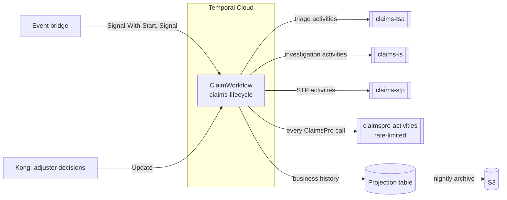

# Approach B: Claim Entity Workflow

One workflow per claim, `ClaimWorkflow`, runs the claim for its whole life (Temporal's entity-workflow pattern).
Triage, investigation and STP are modules inside it; their work runs as activities on each track's own task queue
and worker. External systems sit behind activity interfaces with mock implementations: replacing a mock is a
one-line change in the worker that registers it.

Design document: `design/Approach-B-Claim-Entity-Workflow.pdf`.

## 1. Architecture



| Worker (deployment) | Language | Task queue | Runs |
|---|---|---|---|
| lifecycle-worker | Java | claims-lifecycle | ClaimWorkflow, ArchiveWorkflow; projection, policy, archive activities |
| triage-worker | Python | claims-tsa | `Ai.assessRisk`, `Triage.applyRules` (activities only) |
| investigation-worker | Python | claims-is | `Ai.analyzeCoverage` (activities only) |
| stp-worker as `stp` | Java | claims-stp | Comm Hub, Policy Gate, eClaims, flow activities (activities only) |
| stp-worker as `claimspro` | Java | claimspro-activities | Every ClaimsPro call, rate limit enforced on the queue |

Why one workflow: the tracks need separate workers and deployments, which activities on their own queues already
give; the orchestration (stage, events, decisions, re-triage, payment) is one state machine for one claim. Temporal
does not use child workflows to organise code. One workflow ID receives every event and decision.

## 2. The workflow and what each part carries

| Workflow | ID | Input → output | Receives |
|---|---|---|---|
| ClaimWorkflow | `claim:{claimId}` | `ClaimStart` → none (completes at close) | `claimEvent`, `cancelPayment`, `decide` |
| ArchiveWorkflow | `claims-archive` (schedule) | `ArchiveRequest` → `ArchiveReport` | — |

| Part of ClaimWorkflow | File | Carries | Activities it calls |
|---|---|---|---|
| Stage machine | `ClaimWorkflowImpl`, `Routing` | Stage, stage version, re-triage count; runs the current module or decision; routing table | Policy, Projection, ClaimsPro read and close |
| Triage module | `TriageModule` | Route from AI risk and rules; re-assesses if the claim changes meanwhile | ClaimsPro read, `Ai.assessRisk`, `Triage.applyRules` |
| Investigation module | `InvestigationModule` | Coverage analysis; waits for documents or a reviewer | ClaimsPro read, `Ai.analyzeCoverage` |
| STP module | `StpModule` | The claim's flow: stages in order, steps of a stage in parallel; material change | Flows, Comm Hub, Policy Gate, eClaims, ClaimsPro |
| Payment region | `StpModule.payment` | Approval, create (key looked up first), close; outside every cancellation scope | ClaimsPro create, close, cancel payment |
| Decision desk | `DecisionDesk` | Every human decision of the claim | ClaimsPro tasks |
| Shared state | `ClaimContext` | Activity stubs for every queue, recorder, desk, event flags | — |

Workflows carry IDs and decisions only; activities read current claim data from ClaimsPro. Every message is a
Protocol Buffers type in `contracts/claims/`.

How a claim runs:

1. The event bridge starts `claim:{claimId}` (Signal-With-Start).
2. The stage machine increments the stage version and runs the triage module, which returns a route.
3. It runs the next module. A claim closed or reassigned in ClaimsPro cancels the running module.
4. The STP module runs the claim's flow (`config/stp-flows`) stage by stage; a material change cancels an
   interruptible stage at once and returns the claim to triage.
5. The payment region gets approval above authority, then creates and closes the payment; it is awaited before the
   workflow completes.
6. On close the workflow checks the business record is complete, then completes. A reopen starts a new run.

## 3. Human decisions

The workflow creates an adjuster task in ClaimsPro with `claim:{claimId}` and a decision ID, and waits with a
deadline that escalates through the roles in `config/decision-policy.yaml`. The service behind Kong sends the
`decide` Update to `claim:{claimId}` (decision ID = Update ID). The validator rejects the decision before it is
recorded if the task is closed, the choice is not offered, role or authority is missing, the requester is the
approver, or a required reason is missing.

| Decision | Module | Role |
|---|---|---|
| Triage review (low AI confidence) | Triage | triage-adjuster |
| Manual handling (reason to close), escalation, SIU (reason to deny), reopen review | Stage machine | adjuster, supervisor, siu-investigator |
| Coverage information | Investigation | is-reviewer |
| Customer not reached, no vendor, estimate review | STP | adjuster, appraiser |
| Payment above authority (not the requester; reason to reject) | Payment region | payment-approver |
| Step failing after its retry window | Any | claims-operations |

## 4. Data, S3 and no loss

| Record | Where | Guard |
|---|---|---|
| Business history: a row per step, decision and event acted on | `projection.claim_events` | Awaited, idempotent write; the workflow verifies the claim's record is complete before it completes |
| Stage version | `projection.claim_stage` | Every writing activity refuses a write from an older stage |
| Business archive | S3, nightly | Copied, verified (count and checksum), then deleted |
| Workflow histories | S3 via Temporal Cloud Workflow History Export | Nightly check copies any missing history while Temporal still retains it |

Temporal Archival is a self-hosted feature only (experimental); on Temporal Cloud, Workflow History Export is
Temporal's S3 path. Bucket: versioning, object lock, client KMS key. Retention at least 30 days. One claim has one
workflow ID, so business rows and exported histories join directly.

## 5. Edge cases covered

| Case | Handling |
|---|---|
| Duplicate or late events; 100–150 events per claim | Deduplicated by event ID and handled in place; modules re-read ClaimsPro |
| Created event for a closed claim | New run reads ClaimsPro and ends at once |
| Cosmetic change during STP | Ignored (`MaterialChange`); injury, line of business, state or amount up by half cancel the running stage and re-triage |
| Change during a money stage | Payment and close finish first, then re-triage |
| Late write from an old stage | Refused by the stage-version check |
| Lost reply after a payment was created | Retry finds the payment by key; one payment |
| Claim closed in ClaimsPro | Running module cancelled, tasks withdrawn, unpaid payment cancelled |
| Payment cancelled in ClaimsPro | Payment region stops; honoured until close |
| Reopen while the run is closing | Reviewed in the same run |
| Re-triage loop | Escalation after the configured limit |
| Nobody decides | Escalates role by role; manual handling goes to ESCALATION |
| System outage | Retries with backoff until the retry window, then an operations task; claim never fails |
| AI outage | AI calls capped at 5 attempts, then a person decides |
| Newer contract on one side | Unknown fields and enum values read in both languages; unknown outcome goes to a person |
| Long claim | Continue-As-New between stages, with no decision or payment open |
| Release while claims are running | Workflow changes patched and replay-tested; activity workers release independently |
| Catastrophe surge | ClaimsPro rate-limited; measured 200 claims at 20/s, all closed once with complete records in 58 s |

## 6. Pros and cons

| Pros | Cons |
|---|---|
| One workflow per claim: one history, one ID for every event and decision | One workflow type holds all track logic; a defect affects the whole claim |
| Fewest actions and executions per claim; no forwarding, no child starts | Track teams write activities, not workflows |
| Activity workers (Python AI, Java STP) release without workflow versioning | Every workflow change must be patched and replay-tested |
| Cross-track rules, re-triage and payment in one place | One history grows with every track: Continue-As-New between stages |

## 7. Replacing the mocks

| Mock | Registered in | Replace with |
|---|---|---|
| `MockClaimsProActivities`, `MockCommHubActivities`, `MockPolicyGateActivities`, `MockEClaimsActivities` | `workers/stp-worker/.../Main.java` | Real ClaimsPro, Comm Hub, Policy Gate, eClaims clients |
| `MockRiskAssessor` (`Ai.assessRisk`) | `workers/triage-worker/triage_worker/main.py` | Triage AI agent |
| `MockCoverageAnalyst` (`Ai.analyzeCoverage`) | `workers/investigation-worker/investigation_worker/main.py` | Coverage AI agent |
| `LocalArchiveStore` | `workers/lifecycle-worker/.../Main.java` | S3 `ArchiveStore` |

A real implementation must: keep the interface and activity names; make every write idempotent on
`claimId:stageVersion:step`; look a payment up by its key before creating it; store the decision ID and claim
workflow ID on adjuster tasks; throw `NotFound`, `Refused` or `StaleStage` for business outcomes and let other
failures be retried. The stage-version check wraps every implementation automatically. Then remove the mock pieces:
`MockDataStore` and `MOCK_*` settings, `mock-data/`, `application-simulator/`. The client's event bridge calls
`ClaimEventsClient`; the service behind Kong calls `DecisionClient`.

## 8. Run

```bash
make up                            # build, start, make the build current for every worker
make demo                          # ten claim scenarios end to end
make loadtest CLAIMS=200 RATE=20   # catastrophe surge
make test                          # workflow, contract, routing, material-change and replay tests
```

Scenarios (`mock-data/scenarios`): straight through with a lost payment reply, injury cancels the estimate stage and
re-triages, coverage investigation, SIU denial with reason, large payment four-eyes approval, catastrophe lost event,
customer not reached, low-confidence triage, closed in ClaimsPro then reopened, payment cancelled in ClaimsPro.

Production: one Temporal Cloud namespace per environment over PrivateLink and mTLS; one EKS deployment per queue,
scaled on schedule-to-start latency; releases with a new `BUILD_ID`, ramped and made current; payload key
(`PAYLOAD_KEY`) from the secrets manager; pilot scope with `PILOT_STP_ONLY=true` (Claims Lifecycle to STP only).
Temporal UI locally: http://localhost:48233.

## 9. Layout

```
design/                 Design document
contracts/              Protocol Buffers contracts; golden/ payloads tested in Java and Python
workers/                lifecycle-worker (ClaimWorkflow), stp-worker, triage-worker, investigation-worker
worker-runtime/         Runtime every worker builds on (java/, python/)
config/                 Decision policy, triage rules, STP flows
database/               Projection schema
mock-data/              Mock application data and scenarios (remove with the mocks)
application-simulator/  Stand-in for the client's application (remove with the mocks)
deploy/                 Worker version promotion
```
