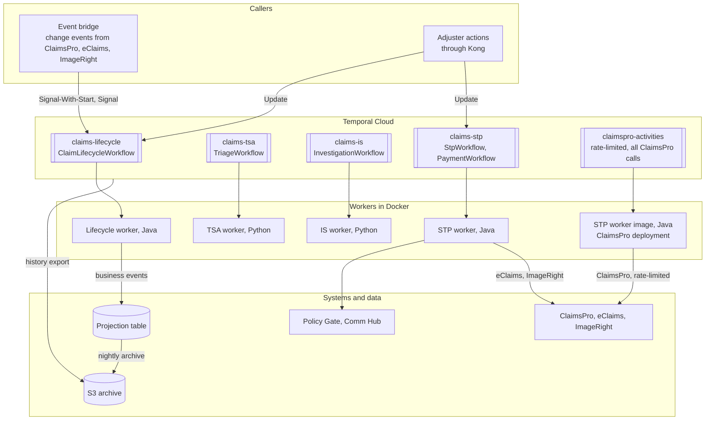
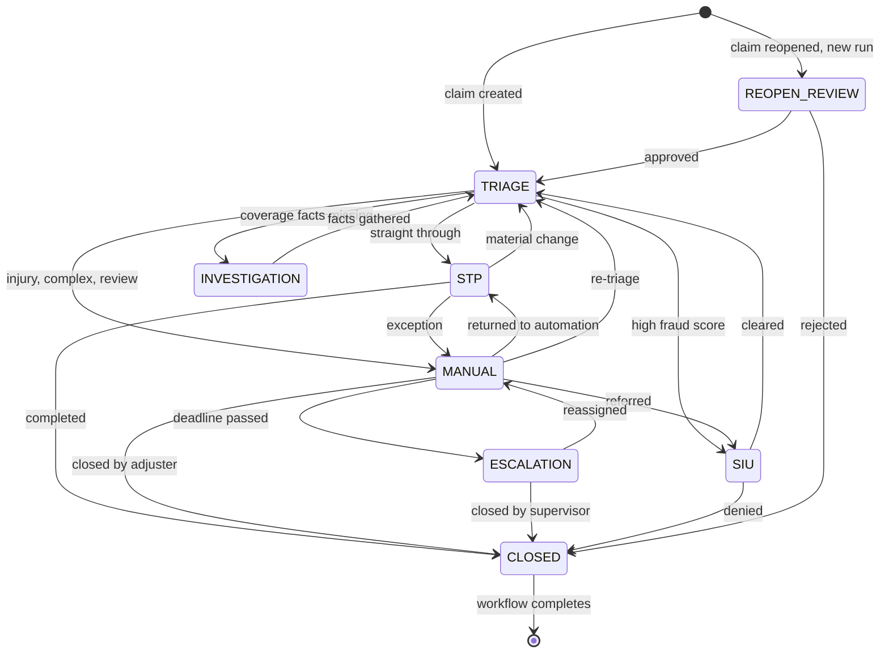

# Claim Orchestrator

The Temporal layer of the claims platform, built exactly to the design *Claims Orchestration on Temporal*
(Design 1, Claim Orchestrator, version 1.1). It contains the workflows, the workers, the activity
interfaces, the Protocol Buffers contracts and the business-history data path. The claims systems are
mocked at the activity boundary only: replacing the mock activities with real ones is the only change
needed to run against ClaimsPro, eClaims, ImageRight, Policy Gate, Comm Hub and the AI agents.

Everything runs in Docker. `make up` starts the stack; `make demo` runs nine claim scenarios end to end
and checks each outcome.

---

## 1. Architecture



| Task queue | Workflows and activities | Worker deployment |
|---|---|---|
| `claims-lifecycle` | ClaimLifecycleWorkflow, ArchiveWorkflow; projection, policy and archive activities | `workers/lifecycle-worker` (Java), Auto-Upgrade |
| `claims-tsa` | TriageWorkflow; AI risk and triage-rule activities | `workers/triage-worker` (Python), Pinned |
| `claims-is` | InvestigationWorkflow; AI coverage activity | `workers/investigation-worker` (Python), Pinned |
| `claims-stp` | StpWorkflow, PaymentWorkflow; Comm Hub, Policy Gate, eClaims and flow activities | `workers/stp-worker` run as `stp` (Java), Pinned |
| `claimspro-activities` | Every ClaimsPro call, from Java and Python workflows; rate limit on the queue | `workers/stp-worker` run as `claimspro` (Java) |

Workers and the event bridge connect outbound only (gRPC with mTLS). Locally the Temporal dev server
stands in for Temporal Cloud, Postgres holds the projection table, and a Docker volume stands in for S3.

## 2. Workflows

| Workflow | Workflow ID | Lifetime | Messages | When its parent closes |
|---|---|---|---|---|
| ClaimLifecycleWorkflow | `claim:{claimId}` | Until the claim closes; reopen is a new run | Signals `claimEvent`, `paymentResult`; Update `decide` | — |
| TriageWorkflow | `claim:{claimId}:tsa:{stage}` | One triage visit | Signal `claimEvent`; Update `decide` | Cancelled |
| InvestigationWorkflow | `claim:{claimId}:is:{stage}` | One investigation visit | Signal `claimEvent`; Update `decide` | Cancelled |
| StpWorkflow | `claim:{claimId}:stp:{stage}` | One STP visit | Signal `claimEvent`; Update `decide` | Cancelled |
| PaymentWorkflow | `claim:{claimId}:payment:{paymentKey}` | Until closed, cancelled or rejected | Signal `cancelPayment`; Update `decide` | Abandoned: keeps running |

**ClaimLifecycleWorkflow** is the only workflow that changes the claim's stage. It starts a new child per
track visit and never has two open: it stops a track by cancellation request, waits for it to close, then
starts the next. Change events from the bridge are deduplicated by event ID and forwarded to the active
track, or held until one starts. The human stages (manual handling, escalation, SIU, reopen review) are
decisions inside the parent. It continues as new only between stages, and completes when the claim closes.



Every stage change increments the **stage version**, recorded in the projection table. Every activity
that writes checks it first and refuses with `StaleStage` if the claim has moved on, so a late write from
an older stage can never land. More re-triages than the configured limit go to ESCALATION. A claim closed
or reassigned directly in ClaimsPro cancels the active track.

**StpWorkflow** runs the steps of the claim's flow definition (`config/flows`, chosen by line of
business, company, channel and state; version and content hash recorded):

| Step | What happens | System |
|---|---|---|
| CONTACT_CUSTOMER | Contact; if not reached, an adjuster decides retry, continue or manual | Comm Hub |
| VERIFY_COVERAGE | Not confirmed goes to a person (a denial is always a person's decision) | Policy Gate |
| OPEN_RESERVE | Reserve for the claimed amount | ClaimsPro |
| DISPATCH_AND_APPRAISAL | Vendor dispatch and appraisal in parallel; no vendor goes to an adjuster | eClaims |
| AWAIT_ESTIMATE | Waits for the estimate event, re-reading eClaims on a timer in case it is lost; above the review threshold an appraiser decides | eClaims |
| PAY | Starts PaymentWorkflow and waits for it | ClaimsPro |
| CLOSE_CLAIM | Closes the claim | ClaimsPro |

On a change event STP re-reads ClaimsPro; a material change ends the visit with `RETRIAGE` once the
in-flight step finishes.

**PaymentWorkflow** asks for approval above the STP payment authority (a different person with enough
authority), then creates and closes the payment. Create looks up the payment key first, so a rerun never
pays twice. It is started outside STP's cancellation scope and abandoned when STP closes, so it is never
stopped halfway; it reports its result to the parent by signal. A cancel signal is honoured until the
payment closes.

**TriageWorkflow** reads the claim, asks the AI agent for a risk assessment, applies the triage rules
(`config/triage-rules.yaml`) and returns a route; below the confidence threshold a triage adjuster
chooses. **InvestigationWorkflow** asks the AI agent whether coverage facts are complete; if not it waits
for documents (an event) or an IS reviewer, then returns `RETRIAGE`.

## 3. Human decisions

The waiting workflow creates an adjuster task in ClaimsPro carrying its **workflow ID** and a **decision
ID**, then waits with a deadline. The service behind Kong sends the adjuster's answer as the `decide`
Update to that workflow ID, with the decision ID as the Update ID (`DecisionClient` in
`shared/runtime-jvm`). The validator rejects the decision before anything is recorded when the task is
closed, the choice is not offered, the user lacks the role or authority, or the requester approves their
own request; a repeated decision ID returns the first result. At the deadline the task moves to the next
escalation role. Open tasks are withdrawn when the claim moves on.

| Decision | Waits in | Role (config) |
|---|---|---|
| Triage review | TriageWorkflow | triage-adjuster |
| Manual handling: close, return to STP, re-triage, refer to SIU | ClaimLifecycleWorkflow | adjuster |
| Escalation: reassign or close | ClaimLifecycleWorkflow | supervisor |
| SIU: clear or deny | ClaimLifecycleWorkflow | siu-investigator |
| Coverage information | InvestigationWorkflow | is-reviewer |
| Customer not reached; no vendor | StpWorkflow | adjuster |
| Estimate review | StpWorkflow | appraiser |
| Payment above authority | PaymentWorkflow | payment-approver, with authority, not the requester |
| Reopen review | ClaimLifecycleWorkflow | adjuster |
| A step still failing after its retry window: retry or stop | The workflow that owns the step | claims-operations |

Roles, deadlines, escalation order and limits are in `config/decision-policy.yaml`, read once per run
and kept in history.

## 4. Data outside Temporal

Temporal holds orchestration state only: IDs, stage and timers. Workflows carry references; activities
read current data from ClaimsPro.

| Record | Where | Written |
|---|---|---|
| Business history: one row per step, decision and event acted on, numbered 1..n per run with a closing row | `projection.claim_events` | By an awaited activity before the workflow moves on |
| Current stage version per claim | `projection.claim_stage` | At every stage change |
| Archived business history | S3 `business/close_date=YYYY-MM-DD/{claimId}.jsonl` | Nightly, for claims closed more than N days ago |
| Workflow histories | S3, by Temporal Cloud history export | Hourly after close; the nightly check writes any missing one while Temporal still retains it |

Nothing is lost when retention ends:

- the workflow does not move on until its projection row is written (insert-if-absent);
- before the claim workflow completes it verifies every run of the claim has contiguous rows and a
  closing row (a payment still running is waited for);
- the archive copies, verifies row count and checksum, and only then deletes;
- the nightly check confirms every closed workflow's history is in S3 and copies any that is missing.

## 5. Contracts

`contracts/claims/v1/*.proto` (package `claims.v1`) is the single definition for Java and Python. Java
classes are generated by the Maven build, Python modules by the worker images. Payloads use the protobuf
JSON encoding, so histories stay readable; with `PAYLOAD_KEY` set they are encrypted with AES-256-GCM by
the same codec in both languages, failure messages included. Search attributes and workflow IDs are not
encrypted and hold IDs only.

Rules: field numbers are never reused (removed fields are reserved); fields are only added; enum value 0
is `*_UNSPECIFIED` and an unknown value goes to a person; workflow, activity, signal and update names are
explicit and listed in `Names.java` and `names.py`.

## 6. The mock boundary

Every external system is an activity interface. The mock implementations read and write mock application
data in the Postgres `mock` schema, seeded from the scenario files in `mock-data/claims`.

| Interface (activity names) | Runs on | Mock | Replace with |
|---|---|---|---|
| `ClaimsProActivities` (`ClaimsPro.*`) | claimspro-activities | `stp-worker/.../mock/MockClaimsProActivities` | ClaimsPro service calls |
| `CommHubActivities` (`CommHub.contactCustomer`) | claims-stp | `MockStpSystemsActivities.CommHub` | Comm Hub |
| `PolicyGateActivities` (`PolicyGate.verifyCoverage`) | claims-stp | `MockStpSystemsActivities.PolicyGate` | Policy Gate |
| `EClaimsActivities` (`EClaims.*`) | claims-stp | `MockStpSystemsActivities.EClaims` | eClaims |
| `Ai.assessRisk` | claims-tsa | `triage_worker/mock_ai.py` | Triage AI agent |
| `Ai.analyzeCoverage` | claims-is | `investigation_worker/mock_ai.py` | Coverage AI agent |
| `ArchiveStore` | Lifecycle worker | `LocalArchiveStore` (folder) | S3 (versioning, object lock, KMS) |

A real implementation keeps the interface and these rules: read current data by the reference passed
in; use `claimId:stageVersion:step` from the `StepRef` as the idempotency key so a repeat returns the
first result; throw `NotFound`, `Refused` or `StaleStage` for business outcomes and let everything else
be retried. The stage-version check is added by the worker around every implementation
(`FencedActivities`), so it is not repeated in real code. Register the real class where the mock is
created in the worker's `Main` / `main.py`; nothing else changes.

Real and kept: projection, policy, flow catalog, triage rules and archive logic.

The application around Temporal is simulated by `tools/claim-sim`, which is not part of the deliverable:
it changes mock claims as ClaimsPro, eClaims and ImageRight would, delivers their change events as the
event bridge does (`ClaimEventsClient` in `shared/runtime-jvm` is the call the real bridge makes), and
decides tasks as adjusters would through Kong.

## 7. Running it

```bash
make up          # build, start, and make the build current for every worker deployment
make demo        # run every scenario end to end; each must close with a complete record
make tasks       # open adjuster tasks
make decide T=TASK-1001 C=APPROVE AS=sup-2 ROLES=payment-approver AUTH=5000000
make history ID=CLM-05-1A2B3C
make archive     # nightly archive and history check, now
make test        # Java and Python workflow tests, replay tests
make down | make clean
```

Temporal UI: http://localhost:28233 (search `ClaimId = "..."`, `OpenDecision = "PAYMENT_APPROVAL"`).

| Scenario (`mock-data/claims`) | Shows |
|---|---|
| 01-straight-through | Full STP; ClaimsPro's reply to create-payment is lost and the retry finds the payment by key |
| 02-injury-retriage | Material change during STP; re-triage to an adjuster; back to STP |
| 03-coverage-investigation | Investigation waits; documents arrive; re-triage; STP |
| 04-fraud-siu | SIU denies |
| 05-large-payment-approval | Estimate review; payment approval rejects the requester and an approver without authority, then accepts |
| 06-catastrophe-lost-event | Catastrophe flow for Texas; the estimate event is lost and the timer re-read finds it |
| 07-customer-not-reached | Adjuster asks for another contact attempt |
| 08-low-confidence-review | Triage adjuster chooses the route |
| 09-closed-then-reopened | Closed directly in ClaimsPro while waiting: track cancelled, task withdrawn; reopened as a new run with stage numbering continued |

`MOCK_FAILURE_RATE` injects random transient failures into the mock systems so retries are exercised.

## 8. Configuration

| Variable | Purpose |
|---|---|
| `TEMPORAL_ADDRESS`, `TEMPORAL_NAMESPACE` | Temporal Cloud endpoint and namespace |
| `TEMPORAL_TLS_CERT`, `TEMPORAL_TLS_KEY` | mTLS client certificate and PKCS8 key |
| `PAYLOAD_KEY`, `PAYLOAD_KEY_ID` | Payload encryption key (base64, 32 bytes); off when empty |
| `BUILD_ID`, `WORKER_VERSIONING` | Worker Versioning build ID |
| `PROJECTION_JDBC_URL`, `PROJECTION_DB_USER`, `PROJECTION_DB_PASSWORD` | Projection table |
| `CLAIMSPRO_RATE_PER_SECOND` | ClaimsPro's agreed request rate, enforced on its queue |
| `RETRY_WINDOW_SECONDS` | Overrides the policy's retry window (shorter locally) |
| `POLICY_FILE`, `FLOWS_DIR`, `TRIAGE_RULES` | Decision policy, STP flows, triage rules |
| `ARCHIVE_DIR`, `ARCHIVE_CRON`, `ARCHIVE_AFTER_DAYS`, `HISTORY_CHECK_HOURS` | Archive schedule and window |
| `METRICS_PORT` | Prometheus endpoint for SDK metrics (0 disables) |

Logs are JSON lines with workflow ID, run ID and claim ID, for ELK.

## 9. Production

- One Temporal Cloud namespace per environment, reached over PrivateLink with mTLS; retention at least
  30 days; history export to S3 enabled.
- One EKS deployment per task queue, scaled on schedule-to-start latency. The ClaimsPro deployment's
  rate limit is enforced by the server across all its pods.
- Release: build with a new `BUILD_ID`, deploy alongside the current build, ramp, then make it current
  (`deploy/promote-versions.sh` shows the commands). Pinned workflows finish on the build they started
  on, so each old build runs until its last pinned workflow closes. ClaimLifecycleWorkflow is on
  Auto-Upgrade: every change must replay the recorded histories (`ReplayTest`), patched with
  `Workflow.getVersion` where it would not.
- The payload key comes from the secrets manager; a codec server for the Temporal UI uses the same key.

## 10. Layout

```
contracts/                 Protocol Buffers contracts (claims/v1) and Java code generation
shared/runtime-jvm/        Java: connection, codec, versioning, stage check, decisions, projection rows, clients
shared/runtime-python/     Python: the same for the Python workers
workers/lifecycle-worker/  ClaimLifecycleWorkflow, ArchiveWorkflow, projection/policy/archive activities
workers/stp-worker/        StpWorkflow, PaymentWorkflow, system activity interfaces and mocks
workers/triage-worker/     TriageWorkflow, triage rules, mock AI agent
workers/investigation-worker/  InvestigationWorkflow, mock AI agent
config/                    Decision policy, triage rules, STP flows
database/                  Projection schema
mock-data/                 Mock application schema and claim scenarios
tools/claim-sim/           Simulator of the surrounding application (mock only)
deploy/                    Worker version promotion
```

## 11. Details still needed

| Detail | Affects |
|---|---|
| Success criteria document | Acceptance |
| Normal and catastrophe-peak claims per hour (from the catastrophe load-test scripts) | Capacity, worker scaling |
| Agreed request rate for ClaimsPro, eClaims, ImageRight | Queue rate limits |
| Which service behind Kong sends the `decide` Update; how adjuster tasks are created and closed, and whether a task can carry the workflow ID | Human decisions |
| Authority matrix, escalation levels, deadlines, business calendar, retry window per system | `config/decision-policy.yaml` |
| What Policy Gate checks; Comm Hub contact rules | STP steps |
| Allowlisted change event types; that the bridge skips changes made by the workflows themselves | Event handling |
| Payment cancellation after close | PaymentWorkflow |
| Variations tool output format | `config/flows` |
| IS steps; how manual, escalation and SIU hand back; reopen rules | Human stages |
| Retention days; archive age; S3 regulatory retention; tool used to query S3 | Archive |
| Whether claimId contains personal data; AWS region; disaster recovery targets | IDs, namespace |
