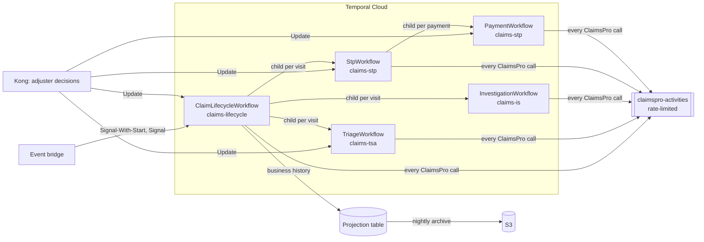

# Approach A: Parent–Child Orchestration

One parent workflow per claim owns the claim's stage. Each visit to a track is a child workflow on that track's own
task queue and worker; each payment is a child of STP. External systems sit behind activity interfaces with mock
implementations: replacing a mock is a one-line change in the worker that registers it.

Design document: `design/Approach-A-Parent-Child-Orchestration.pdf`.

## 1. Architecture



| Worker (deployment) | Task queue | Runs |
|---|---|---|
| lifecycle-worker | claims-lifecycle | ClaimLifecycleWorkflow, ArchiveWorkflow; projection, policy, archive activities |
| triage-worker | claims-tsa | TriageWorkflow; AI risk, triage rules |
| investigation-worker | claims-is | InvestigationWorkflow; AI coverage |
| stp-worker as `stp` | claims-stp | StpWorkflow, PaymentWorkflow; Comm Hub, Policy Gate, eClaims, flows |
| stp-worker as `claimspro` | claimspro-activities | Every ClaimsPro call, rate limit enforced on the queue |

Why parent–child: each child has its own worker fleet (Python AI, Java core), its own owner and release cycle, or
its own lifecycle (a payment must finish even if STP stops). The parent is the single owner of the stage and the
cross-track rules. Dispatch and appraisal have none of these, so they are activities inside STP.

## 2. Workflows and what each carries

| Workflow | ID | Input → output | Receives | Starts | Activities it calls |
|---|---|---|---|---|---|
| ClaimLifecycleWorkflow | `claim:{claimId}` | `ClaimStart` → none (completes at close) | `claimEvent`, `paymentResult`, `decide` | Triage, Investigation, STP children | Policy, Projection, ClaimsPro (read, tasks, close) |
| TriageWorkflow | `claim:{id}:tsa:{stage}` | `TrackRequest` → `TrackResult` (route) | `claimEvent`, `decide` | — | ClaimsPro read, `Ai.assessRisk`, `Triage.applyRules` |
| InvestigationWorkflow | `claim:{id}:is:{stage}` | `TrackRequest` → `TrackResult` | `claimEvent`, `decide` | — | ClaimsPro read, `Ai.analyzeCoverage` |
| StpWorkflow | `claim:{id}:stp:{stage}` | `TrackRequest` → `TrackResult` | `claimEvent`, `decide` | PaymentWorkflow | Flows, Comm Hub, Policy Gate, eClaims, ClaimsPro |
| PaymentWorkflow | `claim:{id}:payment:{key}` | `PaymentRequest` → `PaymentResult` | `cancelPayment`, `decide` | — | ClaimsPro create, close, cancel payment |
| ArchiveWorkflow | `claims-archive` (schedule) | `ArchiveRequest` → `ArchiveReport` | — | — | Archive |

Workflows carry IDs and decisions only; activities read current claim data from ClaimsPro. Every message is a
Protocol Buffers type in `contracts/claims/`.

How a claim runs:

1. The event bridge starts `claim:{claimId}` (Signal-With-Start).
2. The parent increments the stage version and starts a TriageWorkflow, which returns a route.
3. The parent starts the next child. It never has two children open.
4. STP runs the claim's flow (`config/stp-flows`): contact, coverage, reserve, dispatch and appraisal, estimate,
   payment, close.
5. PaymentWorkflow gets approval above authority, then creates (key looked up first) and closes the payment.
6. On close the parent checks the business record is complete, then completes. A reopen starts a new run.

## 3. Human decisions

The waiting workflow creates an adjuster task in ClaimsPro with its workflow ID and a decision ID, and waits with a
deadline that escalates through the roles in `config/decision-policy.yaml`. The service behind Kong sends the
`decide` Update (decision ID = Update ID). The validator rejects the decision before it is recorded if the task is
closed, the choice is not offered, role or authority is missing, the requester is the approver, or a required reason
is missing.

| Decision | Waits in | Role |
|---|---|---|
| Triage review (low AI confidence) | Triage | triage-adjuster |
| Manual handling (reason to close), escalation, SIU (reason to deny), reopen review | Parent | adjuster, supervisor, siu-investigator |
| Coverage information | Investigation | is-reviewer |
| Customer not reached, no vendor, estimate review | STP | adjuster, appraiser |
| Payment above authority (not the requester; reason to reject) | Payment | payment-approver |
| Step failing after its retry window | Owning workflow | claims-operations |

## 4. Data, S3 and no loss

| Record | Where | Guard |
|---|---|---|
| Business history: a row per step, decision and event acted on | `projection.claim_events` | Awaited, idempotent write; the claim workflow verifies every run is complete before it completes |
| Stage version | `projection.claim_stage` | Every writing activity refuses a write from an older stage |
| Business archive | S3, nightly | Copied, verified (count and checksum), then deleted |
| Workflow histories | S3 via Temporal Cloud Workflow History Export | Nightly check copies any missing history while Temporal still retains it |

Temporal Archival is a self-hosted feature only (experimental); on Temporal Cloud, Workflow History Export is
Temporal's S3 path. Bucket: versioning, object lock, client KMS key. Retention at least 30 days.

## 5. Edge cases covered

| Case | Handling |
|---|---|
| Duplicate or late events; 100–150 events per claim | Deduplicated by event ID; held while no child runs; children re-read ClaimsPro |
| Created event for a closed claim | New run reads ClaimsPro and ends at once |
| Cosmetic change during STP | Ignored (`MaterialChange`); injury, line of business, state or amount up by half re-triage the claim |
| Late write from an old stage | Refused by the stage-version check |
| Lost reply after a payment was created | Retry finds the payment by key; one payment |
| Claim closed in ClaimsPro | Active child cancelled, tasks withdrawn, unpaid payment cancelled |
| Payment cancelled in ClaimsPro | Forwarded to the payment; honoured until close |
| Reopen while the run is closing | Reviewed in the same run |
| Re-triage loop | Escalation after the configured limit |
| Nobody decides | Escalates role by role; manual handling goes to ESCALATION |
| System outage | Retries with backoff until the retry window, then an operations task; claim never fails |
| AI outage | AI calls capped at 5 attempts, then a person decides |
| Newer contract on one side | Unknown fields and enum values read in both languages; unknown outcome goes to a person |
| Long claim | Continue-As-New between stages |
| Release while claims are running | Children pinned to their build; parent changes must pass replay tests |
| Catastrophe surge | ClaimsPro rate-limited; measured 200 claims at 20/s, all closed once with complete records |

## 6. Pros and cons

| Pros | Cons |
|---|---|
| Each track team owns and releases its own workflow | More workflows and actions per claim (a child start costs 2 actions, a forward 1) |
| Short histories; a defect in one track stays in that track | Events are forwarded by the parent; decisions are routed to the waiting workflow |
| Payment has its own audit and lifecycle | The task in ClaimsPro must carry the waiting workflow's ID |
| Standard Temporal pattern; matches separate Java and Python teams | Four workflow types to version instead of one |

## 7. Replacing the mocks

| Mock | Registered in | Replace with |
|---|---|---|
| `MockClaimsProActivities`, `MockCommHubActivities`, `MockPolicyGateActivities`, `MockEClaimsActivities` | `workers/stp-worker/.../Main.java` | Real ClaimsPro, Comm Hub, Policy Gate, eClaims clients |
| `MockRiskAssessor` (`Ai.assessRisk`) | `workers/triage-worker/triage_worker/main.py` | Triage AI agent |
| `MockCoverageAnalyst` (`Ai.analyzeCoverage`) | `workers/investigation-worker/investigation_worker/main.py` | Coverage AI agent |
| `LocalArchiveStore` | `workers/lifecycle-worker/.../Main.java` | S3 `ArchiveStore` |

A real implementation must: keep the interface and activity names; make every write idempotent on
`claimId:stageVersion:step`; look a payment up by its key before creating it; store the decision ID and workflow ID
on adjuster tasks; throw `NotFound`, `Refused` or `StaleStage` for business outcomes and let other failures be retried.
The stage-version check wraps every implementation automatically. Then remove the mock pieces: `MockDataStore` and
`MOCK_*` settings, `mock-data/`, `application-simulator/`. The client's event bridge calls `ClaimEventsClient`; the
service behind Kong calls `DecisionClient`.

## 8. Run

```bash
make up                            # build, start, make the build current for every worker
make demo                          # ten claim scenarios end to end
make loadtest CLAIMS=200 RATE=20   # catastrophe surge
make test                          # workflow, contract, material-change and replay tests
```

Scenarios (`mock-data/scenarios`): straight through with a lost payment reply, injury re-triage, coverage
investigation, SIU denial with reason, large payment four-eyes approval, catastrophe lost event, customer not reached,
low-confidence triage, closed in ClaimsPro then reopened, payment cancelled in ClaimsPro.

Production: one Temporal Cloud namespace per environment over PrivateLink and mTLS; one EKS deployment per queue,
scaled on schedule-to-start latency; releases with a new `BUILD_ID`, ramped and made current; payload key
(`PAYLOAD_KEY`) from the secrets manager; pilot scope with `PILOT_STP_ONLY=true` (Claims Lifecycle to STP only).

## 9. Layout

```
design/                 Design document
contracts/              Protocol Buffers contracts; golden/ payloads tested in Java and Python
workers/                lifecycle-worker, stp-worker, triage-worker, investigation-worker; worker-common and
                        ai-worker-common are the libraries the workers build on
config/                 Decision policy, triage rules, STP flows
database/               Projection schema
mock-data/              Mock application data and scenarios (remove with the mocks)
application-simulator/  Stand-in for the client's application (remove with the mocks)
deploy/                 Worker version promotion
```
