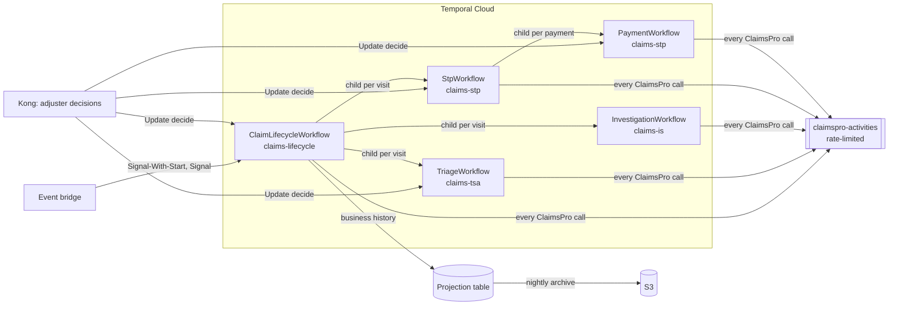

# Parent–Child Orchestration

One parent workflow per claim owns the claim's stage. Each visit to a track (triage, investigation, STP) is a
child workflow on that track's own task queue and worker; each payment is a child workflow of STP. Claim data stays
in ClaimsPro; Temporal holds IDs, stage, timers and decisions. External systems sit behind activity interfaces with
mock implementations, so replacing a mock is a change in the worker that registers it, never in a workflow.

Design document: `design/parent-child-orchestration.pdf`.

## 1. Why Temporal for claims

| Claim requirement | Temporal capability | Where |
|---|---|---|
| A claim lives for weeks with 100–150 events and must never lose its place | Durable workflow state; Signal-With-Start on `claim:{claimId}` | `ClaimLifecycleWorkflowImpl`, `ClaimEventsClient` |
| Systems fail; a claim must wait, not fail | Activity retries with backoff inside a retry window, then an operations task | `ActivityStubs`, `StepRunner` |
| People decide: roles, authority, four eyes, deadlines, escalation | Updates with validators; durable timers | `DecisionDesk`, `config/decision-policy.yaml` |
| A claim closed or changed in ClaimsPro stops or redirects work at once | Signals; cancellation scopes; cancellation requests to children | `claimEvent`, `runTrack` |
| A payment is made once and never stopped halfway | Payment as its own child, ABANDON on parent close, detached scope; idempotent create | `PaymentWorkflowImpl` |
| Separate Java and Python teams release independently | Task queue per track; Worker Versioning (children PINNED, parent AUTO_UPGRADE) | `WorkerSettings`, `deploy/` |
| Catastrophe surges must not overload ClaimsPro | Server-side rate limit on the ClaimsPro task queue | `claimspro-activities` |
| Long claims, unbounded history | Continue-As-New between stages | `continueAsNew()` |
| Audit: who decided what, and why | Business history row per step and decision; workflow histories exported to S3 | `HistoryRecorder`, `ArchiveWorkflow` |

## 2. Architecture



| Worker | Task queue | Runs |
|---|---|---|
| lifecycle-worker | claims-lifecycle | ClaimLifecycleWorkflow, ArchiveWorkflow; Projection, Policy, Archive activities |
| triage-worker | claims-tsa | TriageWorkflow; `Ai.assessRisk`, `Triage.applyRules` |
| investigation-worker | claims-is | InvestigationWorkflow; `Ai.analyzeCoverage` |
| stp-worker as `stp` | claims-stp | StpWorkflow, PaymentWorkflow; Comm Hub, Policy Gate, eClaims, Flow activities |
| stp-worker as `claimspro` | claimspro-activities | Every ClaimsPro call, rate limit enforced by the server |

Why parent–child: each child has its own worker fleet, owner and release cycle, or its own lifecycle (a payment must
finish even if STP stops). The parent is the single owner of the stage and the cross-track rules. Dispatch and
appraisal have none of these, so they are activities inside STP.

## 3. Naming conventions

| Thing | Convention | Example |
|---|---|---|
| Claim workflow ID | `claim:{claimId}`, one per claim | `claim:CLM-1001` |
| Child workflow ID | `claim:{claimId}:{track}:{stageVersion}`, one per visit | `claim:CLM-1001:stp:4` |
| Payment workflow ID | `claim:{claimId}:payment:{paymentKey}` | `claim:CLM-1001:payment:CLM-1001-v4-1` |
| Payment key | `{claimId}-v{stageVersion}-{n}`; ClaimsPro's idempotency key | `CLM-1001-v4-1` |
| Workflow type | `{Purpose}Workflow` | `StpWorkflow` |
| Activity type | `{System}.{operation}` | `ClaimsPro.createPayment`, `Ai.assessRisk` |
| Task queue / deployment | `claims-{track}` (Worker Versioning deployment of the same name) | `claims-tsa` |
| Signal / Update | verb or event name | `claimEvent`, `cancelPayment`, `decide` |
| Decision ID (= Update ID) | `{workflowId}:v{stageVersion}:{kind}:{n}` | `claim:CLM-1001:v3:manual_handling:1` |
| Step / idempotency key | `{claimId}:{stageVersion}:{step}` | `CLM-1001:4:stp.reserve` |
| Search attributes | `ClaimId`, `Stage`, `Track`, `OpenDecision`: IDs and codes only | |
| Contracts | Protocol Buffers, package `claims` | `contracts/claims/*.proto` |

## 4. Workflows

| Workflow | Input → output | Receives | Starts | Calls |
|---|---|---|---|---|
| ClaimLifecycleWorkflow | `ClaimStart` → completes at close | `claimEvent`, `paymentResult`, `decide` | Triage, Investigation, STP children | Policy, Projection, ClaimsPro |
| TriageWorkflow | `TrackRequest` → `TrackResult` (route) | `claimEvent`, `decide` | — | ClaimsPro read, `Ai.assessRisk`, `Triage.applyRules` |
| InvestigationWorkflow | `TrackRequest` → `TrackResult` | `claimEvent`, `decide` | — | ClaimsPro read, `Ai.analyzeCoverage` |
| StpWorkflow | `TrackRequest` → `TrackResult` | `claimEvent`, `decide` | PaymentWorkflow | Flow, Comm Hub, Policy Gate, eClaims, ClaimsPro |
| PaymentWorkflow | `PaymentRequest` → `PaymentResult` | `cancelPayment`, `decide` | — | ClaimsPro create, close, cancel payment |
| ArchiveWorkflow | `ArchiveRequest` → `ArchiveReport` (nightly schedule) | — | — | Archive |

How a claim runs:

1. The event bridge starts `claim:{claimId}` with Signal-With-Start; duplicates and late events are dropped by event ID.
2. The parent increments the stage version (recorded in the projection table) and starts a TriageWorkflow, which
   returns a route: STP, investigation, SIU or manual.
3. The parent starts the next child; it never has two open. Events for the claim are forwarded to the open child or
   held for the next one.
4. STP runs the claim's flow (`config/stp-flows`): contact, coverage, reserve, dispatch and appraisal, estimate,
   payment, close. A material change (injury, line of business, state, amount up by half) ends the visit with
   re-triage, until money has moved.
5. PaymentWorkflow gets approval above STP authority, then creates (key looked up first) and closes the payment.
   STP pays only the balance ClaimsPro shows as unpaid, so no later visit pays twice.
6. On close the parent forwards any pending payment cancellation, verifies the claim's business record is complete
   (every run, gap-free, with a closing row), then completes. A reopen starts a new run that continues the numbering.

## 5. Activities, retries and timeouts

| Activities | Queue | Per attempt | Retry |
|---|---|---|---|
| ClaimsPro: read, reserve, payment, close, tasks | claimspro-activities | 30 s | Backoff 1 s → 60 s (×2) within the retry window (policy, 1 h); then an operations task |
| ClaimsPro tasks, payment close and cancel | claimspro-activities | 30 s | Until done: tasks are how people reach the claim; a created payment always closes |
| Projection (history rows, stage version) | claims-lifecycle | 10 s | Until done: the workflow does not move on until its row is written |
| Comm Hub, Policy Gate, eClaims; Flow | claims-stp | 30 s; 10 s | Retry window, then an operations task |
| AI (`Ai.*`) | claims-tsa, claims-is | 60 s | 5 attempts, then a person decides |
| Triage rules (`Triage.applyRules`, pure code) | claims-tsa | 10 s | Until done |
| Archive | claims-lifecycle | 15 min, heartbeat 1 min | Backoff up to 5 min |

Business outcomes (`NotFound`, `Refused`, `StaleStage`) are not retried; the workflow takes the business path.
Every writing activity is idempotent on its step key and refuses a write from an older stage version, so a late
retry from a cancelled visit cannot change a claim that has moved on.

## 6. Human decisions

The waiting workflow creates an adjuster task in ClaimsPro carrying its workflow ID and a decision ID, and waits
with a deadline that escalates through the roles in `config/decision-policy.yaml`. The service behind Kong sends
the `decide` Update; the decision ID is the Update ID, so a retried call returns the first answer. The validator
rejects, before anything is recorded: a closed task, a choice not offered, a missing role or authority, an approver
who is the requester, and a missing reason where one is required.

| Decision | Waits in | Role |
|---|---|---|
| Triage review (AI confidence below threshold) | Triage | triage-adjuster |
| Manual handling (reason to close), escalation, SIU (reason to deny), reopen review | Parent | adjuster, supervisor, siu-investigator |
| Coverage information | Investigation | is-reviewer |
| Customer not reached, no vendor, estimate review | STP | adjuster, appraiser |
| Payment above authority (not the requester; reason to reject) | Payment | payment-approver |
| Step still failing after its retry window | Owning workflow | claims-operations |

## 7. Data, retention, S3 and no loss

| Record | Where | Guarantee |
|---|---|---|
| Claim data | ClaimsPro | Never copied into Temporal; workflows carry IDs and decisions only |
| Business history: one row per step, decision and event acted on | `projection.claim_events` | Awaited, idempotent write; the claim workflow verifies every run is complete before it completes |
| Current stage version | `projection.claim_stage` | Every writing activity refuses a write from an older stage |
| Business archive | S3, nightly `ArchiveWorkflow` | Only claims whose every run has closed; copied, verified (row count and SHA-256), then exactly the copied rows deleted |
| Workflow histories | S3 via Temporal Cloud Workflow History Export | Nightly check looks back 7 days and copies any history not exported while Temporal still retains it |

Temporal Archival is a self-hosted, experimental feature; on Temporal Cloud, Workflow History Export is the S3
path. Namespace retention: at least 30 days. Bucket: versioning, object lock for the regulatory period, the
client's KMS key. Business rows and exported histories join on workflow ID and run ID.

## 8. Security

- Workers connect outbound only, over PrivateLink with mTLS; no inbound ports.
- Payloads and failure messages are encrypted with AES-256-GCM by one codec, byte-compatible in Java and Python.
  A worker using mTLS refuses to start without `PAYLOAD_KEY`. Keys rotate with `PAYLOAD_PREVIOUS_KEYS`: new data uses
  the new key, older histories still decode.
- The codec server (`python -m claims_runtime.codec_server`) decodes payloads for authorised users of the Temporal
  UI; it runs in the client's account behind SSO and holds the keys, so Temporal never sees them.
- Workflow IDs and search attributes are not encrypted, so they hold IDs and codes only, never personal data.
- The event bridge forwards allowlisted, non-personal change events; activities read claim data from ClaimsPro.
- Decision authority is checked in the workflow (role, authority, four eyes, reason), not only in the UI; the
  payment-authority ceiling of 25,000.00 is in code, so configuration can lower it but never raise it.
- Database and Temporal credentials come from the environment (secrets manager in production).

## 9. Cost and scale

- Temporal Cloud bills by action. A straight-through claim takes about 67 actions across its four workflows
  (measured locally); 50 of them are activities, most of them awaited history rows.
- One child per visit keeps every history short; Continue-As-New between stages bounds the parent's history.
- Workers scale per queue on schedule-to-start latency; ClaimsPro is protected by the queue's rate limit
  (`CLAIMSPRO_RATE_PER_SECOND`), not by worker count.
- Measured locally: 200 claims at 20 per second, all closed once, one payment each, complete records, in 85 s (median claim 62 s).

## 10. Edge cases covered

| Case | Handling |
|---|---|
| Duplicate or late events; 100–150 events per claim | Deduplicated by event ID; forwarded to the open child or held; children re-read ClaimsPro |
| Created event for a closed claim | New run reads ClaimsPro and ends at once |
| Event lost by the bridge | Every wait for an external result also re-reads on a timer; the claim is delayed, not stranded |
| Event for a claim with no running workflow | Not started; the bridge records it for review |
| Cosmetic change during STP | Ignored (`MaterialChange`); injury, line of business, state or amount up by half re-triage the claim |
| Material change after payment | Recorded; STP closes the claim; a reopen brings it to an adjuster |
| Claim returns to STP after a payment | Pays only the unpaid balance; nothing if fully paid |
| Late write from an old stage | Refused by the stage-version check |
| Lost reply after a payment was created | Retry finds the payment by key; one payment |
| Claim closed in ClaimsPro | Active child cancelled, tasks withdrawn, unpaid payment cancelled |
| Payment cancelled in ClaimsPro | Forwarded to the payment; every cancellation is forwarded before the run ends |
| Reopen while the run is closing | Reviewed in the same run |
| Re-triage loop | Escalation after the configured limit |
| Nobody decides | Escalates role by role; manual handling goes to ESCALATION |
| ClaimsPro or another system down | Retries until the retry window ends, then an operations task; the claim never fails |
| AI down | 5 attempts, then a person decides |
| Newer contract on one side | Unknown fields and enum values read in both languages; an unknown outcome goes to a person |
| Long claim | Continue-As-New between stages |
| Release while claims are running | Children pinned to their build; workflow changes behind `Workflow.getVersion`, proven by replay tests |
| Row written while the claim is being archived | Kept for the next archive run; never deleted unarchived |
| Payload key rotated | Old histories decode with the previous key |
| Catastrophe surge | ClaimsPro rate-limited; all claims close once |

## 11. Pros and cons

| Pros | Cons and how they are handled |
|---|---|
| Standard Temporal pattern; each track team owns and releases its own workflow | Four workflow types to version; children are pinned to their build, the parent is patched and replay-tested |
| One owner of the stage; tracks cannot hand off to each other or loop without limit | Every forwarded event costs one action (100–150 events per claim) |
| Short histories; a defect in one track stays in that track | A new child per visit adds actions and a short start-up delay at each stage change |
| Payment has its own audit trail and lifecycle | Decisions go to the waiting workflow, so the ClaimsPro task must carry its workflow ID |
| Late or stale writes refused; payments never doubled or stopped halfway | Every writing activity reads the stage version first: one extra read per write |
| Decisions answered at once and validated before they are recorded | Updates need a running worker; the caller retries with the same decision ID |
| A surge cannot overload ClaimsPro; tracks scale independently | The rate limit slows claims in a surge instead of failing them |
| Nothing is lost when retention ends | The projection table is on the critical path: if it is down, claims wait |

## 12. Replacing the mocks

| Mock | Registered in | Replace with |
|---|---|---|
| `MockClaimsProActivities`, `MockCommHubActivities`, `MockPolicyGateActivities`, `MockEClaimsActivities` | `workers/stp-worker/.../Main.java` | ClaimsPro, Comm Hub, Policy Gate, eClaims clients |
| `MockRiskAssessor` (`Ai.assessRisk`) | `workers/triage-worker/triage_worker/main.py` | Triage AI agent |
| `MockCoverageAnalyst` (`Ai.analyzeCoverage`) | `workers/investigation-worker/investigation_worker/main.py` | Coverage AI agent |
| `LocalArchiveStore` | `workers/lifecycle-worker/.../Main.java` | S3 `ArchiveStore` |

A real implementation keeps the interface and activity names, makes every write idempotent on its step key, looks
a payment up by its key before creating it, reports `paid_cents` on the claim, stores the decision ID and workflow
ID on adjuster tasks, and throws `NotFound`, `Refused` or `StaleStage` for business outcomes, letting every other
failure be retried. The stage-version check wraps every implementation automatically. Then remove `MockDataStore`,
the `MOCK_*` settings, `mock-data/` and `application-simulator/`. The client's event bridge calls
`ClaimEventsClient`; the service behind Kong calls `DecisionClient`.

## 13. Run and verify

```bash
make up                            # build, start, make the build current for every worker
make demo                          # ten claim scenarios end to end
make loadtest CLAIMS=200 RATE=20   # catastrophe surge
make test                          # workflow, replay, contract, codec and rule tests
make verify                        # all of the above
```

Scenarios (`mock-data/scenarios`): straight through with a lost payment reply, injury re-triage, coverage
investigation, SIU denial with reason, large payment four-eyes approval, catastrophe lost event, customer not
reached, low-confidence triage, closed in ClaimsPro then reopened, payment cancelled in ClaimsPro.

Production: one Temporal Cloud namespace per environment; one EKS deployment per queue; releases with a new
`BUILD_ID`, ramped and then made current; `PAYLOAD_KEY` from the secrets manager; pilot scope with
`PILOT_STP_ONLY=true` (Claims Lifecycle to STP only). Temporal UI locally: http://localhost:28233.

Operations: the namespace is replicated across three availability zones; multi-region replication is an option
(recovery point under one minute, recovery time about 20 minutes). Logs in ELK carry claim, workflow and run IDs;
SDK metrics go to dashboards; alerts on workflow task failures, queue latency, overdue decisions, steps past their
retry window, and export or archive failures.

## 14. Layout

```
design/                 Design document
contracts/              Protocol Buffers contracts; golden/ payloads tested in both languages
workers/
  lifecycle-worker/     Claim workflow, archive
  stp-worker/           STP and payment workflows; ClaimsPro, Comm Hub, Policy Gate, eClaims activities
  triage-worker/        Triage workflow; AI risk and rules
  investigation-worker/ Investigation workflow; AI coverage
  worker-common/        Shared library of the lifecycle and STP workers
  ai-worker-common/     Shared library of the triage and investigation workers
config/                 Decision policy, triage rules, STP flows
database/               Projection schema
deploy/                 Worker version promotion
mock-data/              Mock application data and scenarios (removed with the mocks)
application-simulator/  Stand-in for the client's application (removed with the mocks)
```
